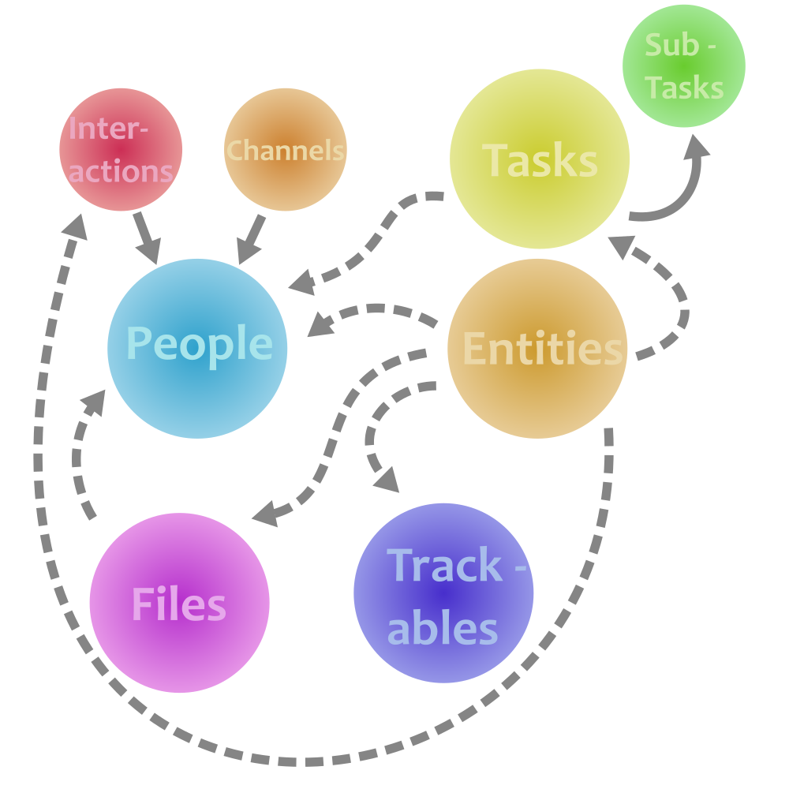

# Hub

Hi! This is Zach, the human behind this agentic generated code. In plain English, this is what the hub is supposed to do:

Organize life happenings in an actionable way.

Or a more traditional, technical description - **It's a CRM-Like project, designed for humans and agents to create action-items, based on what you want to do, who you know, based on resources that you have (like files, relations, etc)**

I'd like to think of it less as a "second brain", and more of a do-er system. The core of it all is designed to be centralized, and not directly tied to something like Salesforce, Monica, or Odoo (though, they were inspirations); it's just you, and whatever interface you're looking to utilize to insert relevant data.

# What are some use-cases?

- Remember previous conversations with contacts
- track progression on things like coding projects, business operations, or studying material
- Link up that one picture of your pizza to your pizza cooking adventure (or... several)
	- Or like, something else such as recipe files, slideshows about that pizza, or a professional word document about that pizza (Professional pizza)
- Link all those things together: "Sally is connected to my pizza cooking adventure, the recorded interaction shows that she liked the taste, could use more pepperoni"
  - Which can be done by: `hub add-interaction --person "sally" --kind "irl" --date "2026-11-1" --summary "Sally is connected <...>"`

---

That's what you can do purely on it's own. This project was designed for agents (e.g OpenClaw, OpenCode). Toss an agent a prompt like this:

```
Here's my brain dump:

- My friend drew just got a new PC, I'll need to call him back at 0000000000 to schedule a time and pay a visit
- The sink broke, I need to figure out how to plumb it back to shape (can you help me?)
- Our major project at work has finished!

<Added new friend: Drew with linked phone number. Added a task with note "schedule a time to repair PC">
<Found existing entity under slug: sink-model-name; a sub-agent is finding supporting documentation and linking it to a file under ~/hub/sink-model-name/directions.md>
<Marked "The big project" as `done`, nice work!>
```

Or perhaps:

```
<Phone call> "Hey man! I got a new contact that came from an email, could you look it up, add it to the hub, and send me a contact file?"
<Agent> Done! I found John Doe in the most recent email, his contact file has been sent over Signal.
```

Better yet:

```
I need an overview of what I'm doing this week, can we print out a summary?

<Agent> Done! Printed out a PDF summary from Brother HL-2240 based on active To-Do's from the hub.
```

Doing it this way becomes an addition to a more powerful system. You can of course create bash scripts that utilize the hub or use it manually; what matters is **the ability to centralize ideas into actionable items**.

# What does it look like? (Schema)



## Breakdown

There's a lot here! But here's what it all means:

### Entities
  
Anything really; a pizza shop, laptop, a corporate entity.

* It has `kind`, to describe what it is generally, `label` for a proper name (e.g "Mellow Mushroom" ), and `content` to help you describe it even more (e.g "Great pizza place! Has unique, and exclusive pizzas depending on which one you visit")
* Entities also have a `slug` - so a way to easily identify it. Used for finding a file later, or linking this up to a **person**
* Can link to literally anything below

### People

Contacts (Or agents, ~~because they're people too~~) you want to keep track of

* Also has a `slug`, just like **entities**, for keeping track of files and linking said **entities**
* Links directly to **channels**, ways to talk to people
* Has a lot of other standard fields, like `first-name`, `last-name`, `employer`, and `relationship-type` (e.g Mother / father)
* Small space to take `notes`

#### Channels

ways to reach a **person**, like phone number, email, signal, linkedIn, take your pick!

* `kind` describes whether it's a phone number, email, etc
* `value` is the actual space to store the contact into
* `source` is where you found the info
* `primary` - is this the main way to talk to the linked **person**?

#### Interactions

Notable times you chatted with a **person**

* Useful for remembering when something last happened. E.G - "did we wind up chatting about hiking yet"?
* Records the date
* Linkable to a person via `--person` ! (Or not, they can be standalone)

### Files

Stuff on the file-system linked to either a **person** or an **entity**, via it's `slug`

By convention, files are linked by default nearby the hub. One example path:

```
~/hub/files/slug-for-entity-or-person/user-icon.png
```

Internally there's nothing stopping someone from linking a file *anywhere* in the file-system as long as the path resolves. Despite flexibility, it's good to have things kept in one place (`~/hub/files`), but up to you!

* `kind` has the file extension, so `jpg`, `pdf`, `md`
* `task` links this to a **task**
* `person` links this to a person

Though, you can still link these to an entity via `hub link-entity`

### Trackables

Stuff you gotta keep track of! More granular than a **task**. It's like a jira ticket

- `label` - "Add a user changeable icon!"
- `kind` - What's it about?
- `party` - who/what is it related to? (e.g "ACME" / "Project")
- `stage` - Started, Finished, Almost done, anything
- `status` - active / closed

**Trackables** also have a **Trackable-event**, so receipts to see how progress is going live beyond the "started, in progress, etc"

### Tasks

Less complex than a **trackable**, more like something from a todo list

* Has contextual information, like `notes`, what it's about (`context`, `title`)
* Stores the status (ready / in progress / completed)
* can be linked to a person (or entity via `link-entity`)
* Has `due-date`s

#### Sub-tasks

Less complex than a **task**, and least complex part of the entire schema!

- `label` describes the task
- `done` is `1` or `0`

# Usage

See: [USAGE.md](./docs/USAGE.MD)
 (Or `hub --help`)

 (Did I forget to mention? **Tab completion is a thing!**)

## Quick Start

Add someone:

```bash
hub add-person --name "John Smith" --employer "ACME" --notes "Stellar performer, great at bowling!"
```

Then add a phone number for John:

```bash
hub add-channel john-smith --kind "phone" --value "123456789" --primary
```

And add a task related to him:

```bash
hub add-task --title "Go bowling" --person "john-smith" --notes "I'll get a strike before John does... BRING IT ON" --context "personal"
```

Remember the bowling alley:

```
hub add-entity --kind "place" --label "Super Duper Turkey Bowl" --content "The place of the final countdown"
```

And possibly store a picture (put one inside `~/hub/files/super-duper-turkey-bowl`)

```bash
hub add-file --path "~/hub/files/super-duper-turkey-bowl/i-beat-john.jpeg" --kind "jpeg" --note "I GOT 'EM, YYYYYYES! WINNER WINNER TURKEY DINNER!!!"

hub link-entity super-duper-turkey-bowl --target-type file --target 1 # 0 is the file ID, you get that back when adding a file
```


## Skills

A `@hub` skill was created for OpenCode and OpenClaw under `./.agents`! - allows for learning to use the hub immediately and then applying any changes you want from it

OpenClaw users will need to insert this into `~/.openclaw/workspace/skills` - as the agent will not read the skills from this repo directly.

# Future Plans

- [ ] Vector search
- [ ] Trello integration
- [ ] VCard Export (necessary? LLMs do this well)
- [ ] Automatic file sync (When a slug has a directory created for it; track changes and record that in the hub)
- [ ] Task priority (low/medium/high)
